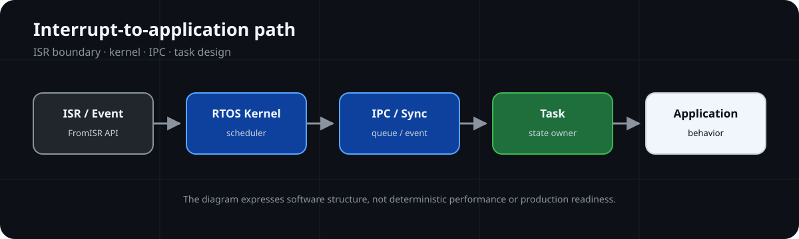
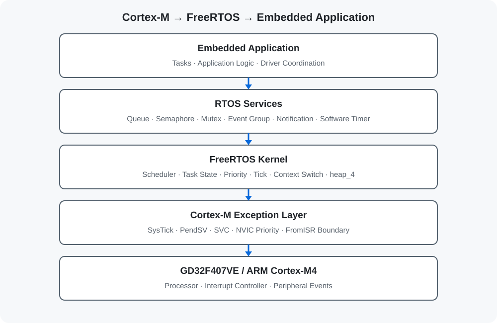

# FreeRTOS-Embedded-Lab

An original, executable multi-task application built on the
[official FreeRTOS Kernel](https://github.com/FreeRTOS/FreeRTOS-Kernel).
The pinned V11.3.2 Kernel runs through its POSIX or MinGW Host Port. The
historical Cortex-M learning material remains an architecture reference.



## What runs

| Part | Implemented behavior |
| --- | --- |
| Kernel | Official FreeRTOS V11.3.2, pinned to `8a59a4b19bf72977819feddef87d41163ced7004` as a Git submodule |
| Tasks | Producer, consumer, and reporter created with `xTaskCreate()` and run by `vTaskStartScheduler()` |
| Queue | Four `SampleInput` elements; FIFO, controlled full-queue failure, bounded receive timeout |
| Notification | Counted `xTaskNotifyGive()` / `ulTaskNotifyTake()` for results and completion |
| Synchronization | FreeRTOS Mutex protects shared statistics and results; a counting semaphore gates task startup for the notification timeout check |
| Application | 12-bit synthetic samples, sequence validation, inclusive hysteresis, explicit invalid-input behavior |
| Evidence | Seven independent application tests and three real-Kernel scenarios: `normal`, `backpressure`, `timeout` |

The [runtime engineering notes](docs/rtos-runtime-foundation.md) explain
task priorities, exact assertions, resource lifecycle, heap/stack settings,
and the Host Port boundary.

## Run the real Kernel

```sh
git clone https://github.com/REliasCheng/FreeRTOS-Embedded-Lab.git
cd FreeRTOS-Embedded-Lab
git submodule update --init --recursive
cmake -S . -B build -G Ninja -DCMAKE_BUILD_TYPE=Debug
cmake --build build --parallel
ctest --test-dir build --output-on-failure
./build/rtos_demo normal
./build/rtos_demo backpressure
./build/rtos_demo timeout
```

Windows/MinGW produces `build/rtos_demo.exe`. Linux builds use the official
`GCC_POSIX` Port; MinGW builds use the official `MSVC_MINGW` Port. The CI
workflow runs the three scenarios with GCC and Clang on Ubuntu and applies
ASan/UBSan to independent application logic tests. Every scenario uses
assertions on actual Queue, notification, Mutex, and processed data, and
returns a failure exit code when they do not match.

## Architecture and study notes



- [Runtime foundation](docs/rtos-runtime-foundation.md)
- [Source and asset decisions](docs/source-provenance.md)
- [Kernel and scheduler](docs/kernel-and-scheduler.md)
- [Task management](docs/task-management.md)
- [Task communication](docs/task-communication.md)
- [Synchronization](docs/synchronization.md)
- [Cortex-M interrupts](docs/cortex-m-interrupts.md)
- [Memory management](docs/memory-management.md)
- [FreeRTOS configuration](docs/freertos-configuration.md)
- [Development environment](docs/development-environment.md)

## Verification boundary

This is a genuine FreeRTOS **Host** runtime, using synthetic sensor input.
It does not include a GD32/STM32 board adapter, target startup/linker files,
device drivers, a Cortex-M target build, or hardware interrupt/real-time
measurements. The Host `GCC_POSIX` Port does not establish MCU scheduling
latency or safe `FromISR` use. Third-party and course-source boundaries are
recorded in [THIRD_PARTY_NOTICES.md](THIRD_PARTY_NOTICES.md); the repository's
MIT license covers only its maintainer-authored files.
